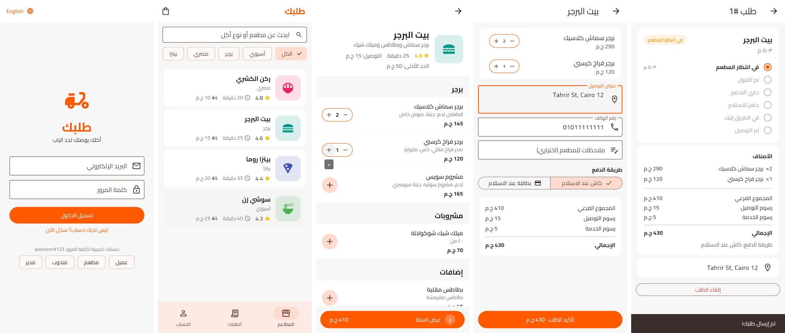
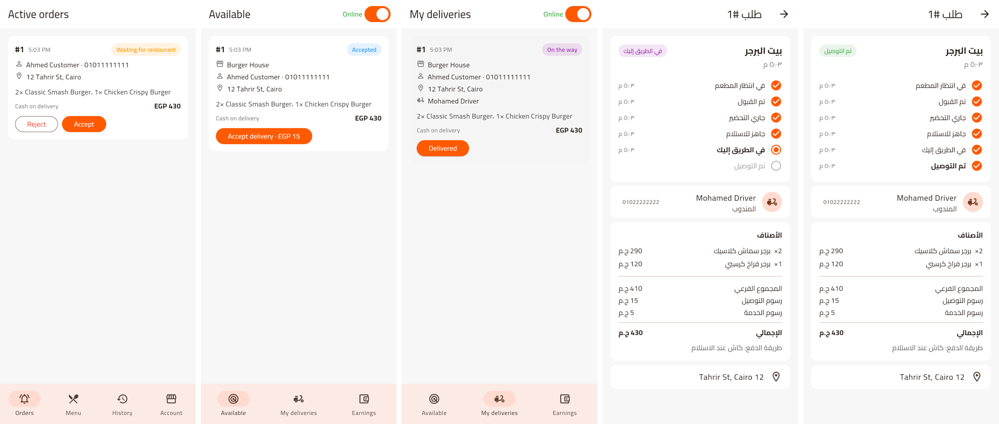
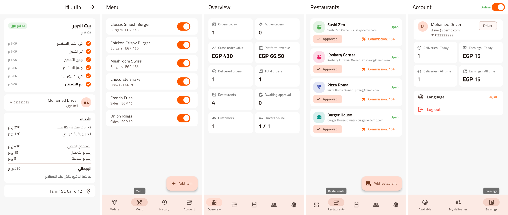

# Talabak — food delivery app (Talabat-style)

One Flutter app (Android / iOS / Web) plus a Node.js API covering the four sides of a delivery marketplace:

| Role | What they can do |
|---|---|
| **Customer** | Browse and search restaurants, filter by category, view menus, cart (one restaurant at a time), checkout (cash / card on delivery), live order tracking, cancel while pending, order history |
| **Restaurant** | Incoming orders (accept / reject → preparing → ready), menu management (add / edit / delete / mark unavailable), open/closed switch, sales stats |
| **Driver** | Online/offline switch, list of orders waiting for a driver, claim an order, mark picked up / delivered, earnings |
| **Admin** | Platform stats (orders, GMV, platform revenue), approve restaurants and set commission, add restaurants with owner logins, enable/disable users, view all orders and force a status, service fee setting |

The whole UI is bilingual **Arabic / English**, with full right-to-left layout in Arabic. It uses the bundled Cairo font.





## Order lifecycle

```
pending ──restaurant──▶ accepted ──▶ preparing ──▶ ready ──driver──▶ picked_up ──▶ delivered
   │                        ▲ a driver can claim the order from "accepted" onward
   ├─restaurant──▶ rejected
   └─customer────▶ cancelled
```

The server enforces every transition, so each role can only make the moves listed above. Prices and totals are always computed on the server from the database. Order total = subtotal + restaurant delivery fee + platform service fee. Platform revenue = commission % × subtotal + service fee.

## Project layout

```
backend/    Node.js 22 + Express + built-in SQLite (node:sqlite), JWT auth
  src/routes/{auth,customer,restaurant,driver,admin}.js
  test/api.test.js         end-to-end API test across all roles
mobile/     Flutter app (one app, screen set chosen by the logged-in role)
  lib/screens/{auth,customer,restaurant,driver,admin}/
  lib/l10n.dart            Arabic + English strings
  lib/config.dart          API URL
```

## Run it

### 1. Backend

Requires Node.js 22.13 or newer.

```bash
cd backend
npm install
npm start          # http://localhost:3000 — seeds demo data on first run
```

To reset the demo data, run `npm run seed`. To run the API tests, run `npm test`.

Demo accounts all use the password `password123`:
`customer@demo.com`, `driver@demo.com`, `admin@demo.com`, and the restaurants `burger@demo.com`, `pizza@demo.com`, `koshary@demo.com`, `sushi@demo.com`.
The login screen has one-tap buttons that fill these in.

### 2. Mobile app

Requires Flutter 3.50 or newer. The app imports `package:material_ui`.

```bash
cd mobile
flutter pub get
flutter run                       # Android emulator uses http://10.0.2.2:3000/api automatically
flutter run -d chrome             # web uses http://localhost:3000/api
```

On a **real phone**, point the app at your computer's LAN IP:

```bash
flutter run --dart-define=API_URL=http://192.168.1.10:3000/api
```

## Configuration

| Variable | Default | Notes |
|---|---|---|
| `PORT` | `3000` | API port |
| `JWT_SECRET` | `dev-secret-change-me` | **Must** be set when `NODE_ENV=production`, otherwise the server refuses to start |
| `DB_FILE` | `backend/data.db` | SQLite file |

## Before going to production

This is a working first version. A real launch still needs:

- **Maps and live location**: customer address pin, driver GPS tracking, distance-based delivery fees (Google Maps / Mapbox).
- **Push notifications** for new orders and status changes (Firebase Cloud Messaging). The app currently polls every 5 seconds.
- **Online card payments** (Paymob / Stripe / Fawry). Today "card" means a card machine on delivery.
- **Images** for restaurants and menu items (upload to S3 / Cloudinary).
- Ratings and reviews, promo codes, saved addresses, phone OTP login.
- Postgres instead of SQLite for multiple servers, HTTPS, rate limiting, and removing `usesCleartextTraffic` / `NSAllowsLocalNetworking`, which are only there for local HTTP during development.
- App store assets: app icon, splash screen, and bundle id (currently `com.example.delivery_app`).
